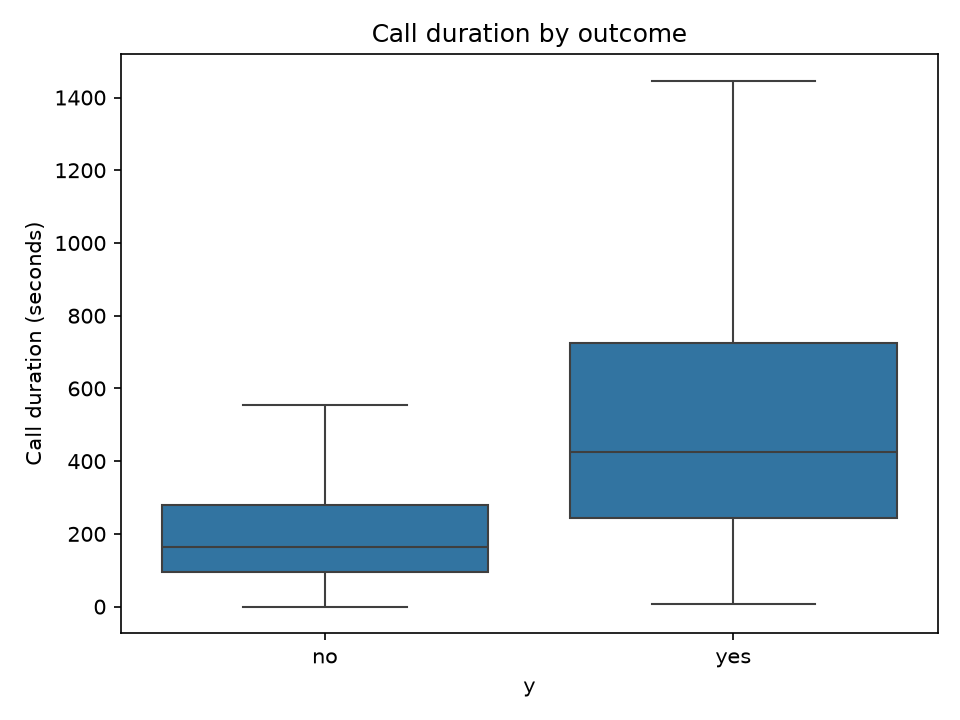
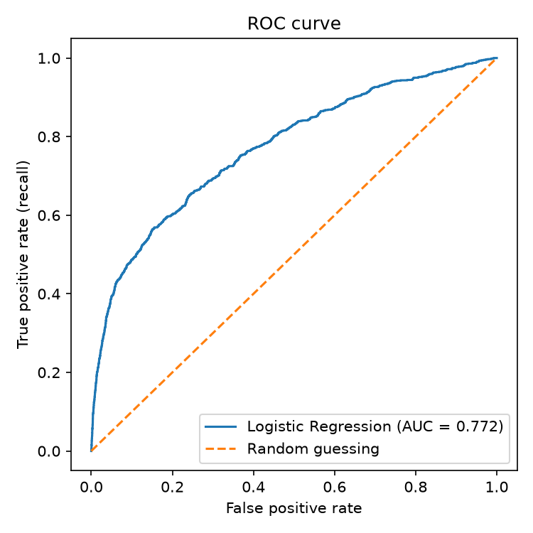
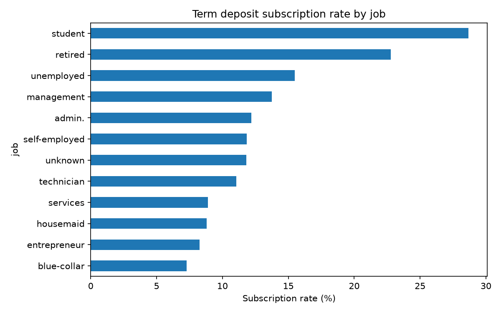
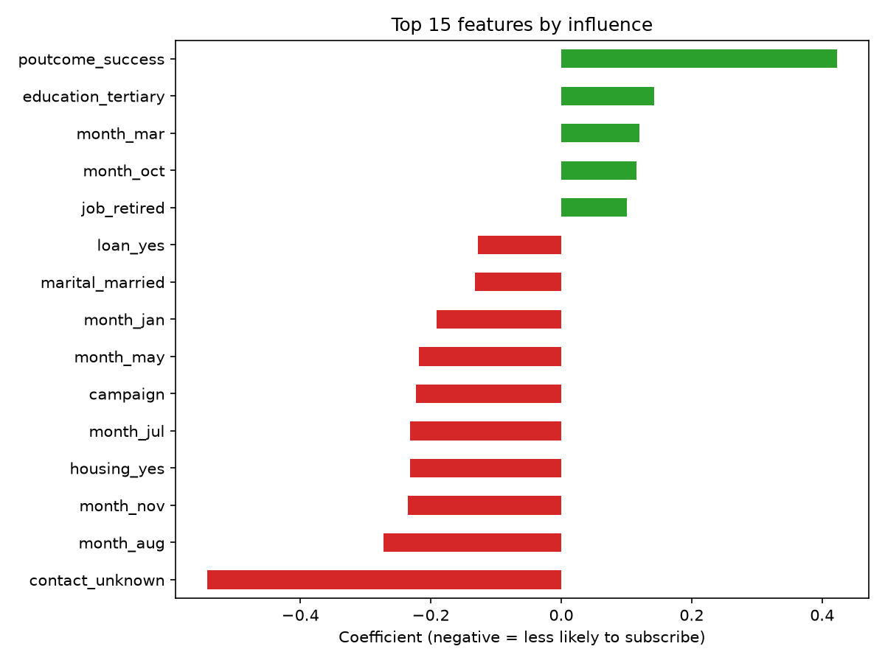

# Bank Term Deposit Prediction

A Logistic Regression model that predicts whether a bank customer will subscribe to a term deposit.

## Problem

A bank wants to spend its phone calls on customers who are likely to say yes. Using the Bank Marketing dataset, I built a model that looks at a customer's age, job, balance, loans and past contact with the bank, and predicts yes or no.

## Dataset

The file is `bank-full.csv`: 45,211 customers, 17 columns, values separated by semicolons. The target column is `y`, which says whether the customer subscribed.

Only 11.7% of customers said yes (5,289 of 45,211). That imbalance shapes most of the decisions below.

No cells are empty, but four columns use the text `unknown` where the information is missing: `job` (288 rows), `education` (1,857), `contact` (13,020) and `poutcome` (36,959).

The data is not in this repo. Download it from the assignment link and save `bank-full.csv` in a folder called `data/`.

## Repository structure

```
bank-term-deposit-prediction/
├── data/                    not tracked by Git, put bank-full.csv here
├── images/                  charts used in this README
├── notebooks/
│   ├── 01_bank_eda.ipynb    exploring the data
│   └── 02_bank_model.ipynb  preparing the data, training and evaluating
├── requirements.txt
└── README.md
```

## How to run it

I used Python 3.11 on Windows.

```
git clone https://github.com/MahatazMahe/bank-term-deposit-prediction.git
cd bank-term-deposit-prediction
python -m venv .venv
.venv\Scripts\activate
pip install -r requirements.txt
```

Put `bank-full.csv` in `data/`, open the notebooks in VS Code, pick the `.venv` kernel, and run `01_bank_eda.ipynb` before `02_bank_model.ipynb`.

## Approach

### Exploring the data

In the first notebook I looked at the shape of the table, the column types, missing values and the balance of the target. I also plotted the subscription rate for each job.

### Dropping `duration`

`duration` is the length of the sales call in seconds. Customers who subscribed talked for 537 seconds on average, and those who did not talked for 221. This looks like a strong clue, but the bank only knows the call length after the call has ended, when the customer has already answered. A model that uses it would be learning from information it can never have at prediction time. This is called data leakage. I removed the column so the model only uses facts available before the call.



### Preparing the data

The second notebook starts by turning `y` into 1 for yes and 0 for no, and keeping the other 15 columns as features.

Logistic Regression needs numbers, so I one-hot encoded the text columns with `pd.get_dummies(drop_first=True)`. This grew the features from 15 to 41 columns. The `unknown` values stay as a category of their own. Dropping those rows would have thrown away most of `poutcome` and a third of `contact`.

I split the data 80/20 into training and test sets, using `stratify=y` and `random_state=42`. Both sets keep the 11.7% yes-rate, with 36,168 training rows and 9,043 test rows.

Then I scaled the features with `StandardScaler`. The scaler learns its averages from the training set only and is then applied to the test set. If the test set helped set the scale, information from the exam would leak into the training.

### Training

I trained two models. The first is a plain Logistic Regression. The second adds `class_weight="balanced"`, which makes each "yes" customer count for more during training so the model does not simply ignore the smaller group.

### Evaluating

Both models were scored on the same 9,043 test customers. I looked at accuracy, the confusion matrix, precision, recall, F1 and the ROC curve with its AUC.

## Results

A model that answers "no" for everyone is already 88.3% accurate on this test set, so accuracy alone says little.

| | Plain model | Balanced model |
|---|---|---|
| Accuracy | 0.894 | 0.756 |
| Precision (yes) | 0.67 | 0.27 |
| Recall (yes) | 0.18 | 0.62 |
| F1 (yes) | 0.28 | 0.37 |
| Real subscribers found | 190 of 1,058 | 659 of 1,058 |
| Wrong "yes" predictions | 95 | 1,810 |

Confusion matrix of the balanced model. Rows are the real answer and columns are the prediction.

| | Predicted no | Predicted yes |
|---|---|---|
| Actually no | 6,175 | 1,810 |
| Actually yes | 399 | 659 |

The balanced model has an ROC AUC of 0.772.



## Findings

The plain model has high accuracy and little use. At 89.4% it is barely better than always saying no. It predicted "yes" for only 285 of the 9,043 test customers and found 190 of the 1,058 who really subscribed.

The balanced model finds 659 of those 1,058, more than three times as many. In exchange, only 27% of its "yes" predictions are right and accuracy drops to 75.6%. For a bank, one extra call to someone who says no costs very little, while a missed customer who would have subscribed is a lost sale. So I chose the balanced model and put recall ahead of accuracy.

Some groups respond far more than others. Students subscribe 28.7% of the time and retired people 22.8%. Blue-collar workers subscribe 7.3% of the time.



The model's coefficients show what it leans on. A successful earlier campaign (`poutcome_success`) is the strongest push toward yes, followed by tertiary education and being retired. The strongest push toward no is an unknown contact type: those customers subscribed 4.1% of the time, against 14.9% for customers reached on a cellular phone. Having a housing loan, having a personal loan and being contacted many times in the same campaign also lower the chance.

Several `month` columns appear among the top features too. They describe when the call was made and not who the customer is, so I read them as a hint about timing and not as a trait of the customer.



## Limitations

- I used the default 0.5 cutoff. Picking the cutoff from the real cost of a call and the value of a sale could balance precision and recall better.
- All results come from a single train/test split. Cross-validation would give a steadier estimate.
- `pdays` is -1 for customers who were never contacted before, and I treated it as an ordinary number. A separate "never contacted" flag might work better.
- An AUC of 0.77 is modest. That is expected once `duration` is removed, but it means the model can help rank customers and cannot be trusted to decide on its own.

## Tools

Python 3.11, pandas, NumPy, scikit-learn, Matplotlib, seaborn, Jupyter in VS Code, Git and GitHub.
